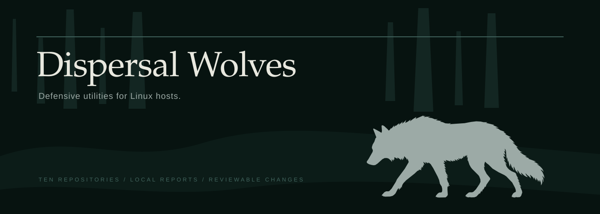

  

Dispersal Wolves maintains ten defensive utilities for Linux hosts. The tools inspect system state, record changes and prepare reviewable configuration without requiring a shared control plane.

## Repository index

| Repository | Purpose |
|---|---|
| [**Host Check**](https://github.com/dispersal-wolves/host-check) | Reports host posture, services and firewall state. |
| [**Open Ports**](https://github.com/dispersal-wolves/open-ports) | Records listening ports and reports what changed. |
| [**SSH Guard**](https://github.com/dispersal-wolves/ssh-guard) | Reviews OpenSSH configuration and prepares policy changes. |
| [**Honeyfile**](https://github.com/dispersal-wolves/honeyfile) | Records access to files that should remain untouched. |
| [**File Watch**](https://github.com/dispersal-wolves/file-watch) | Maintains a local SHA-256 integrity baseline. |
| [**Secret Sweep**](https://github.com/dispersal-wolves/secret-sweep) | Scans local files and staged changes for credentials. |
| [**Container Check**](https://github.com/dispersal-wolves/container-check) | Reviews Compose files for host exposure. |
| [**Firewall Kit**](https://github.com/dispersal-wolves/firewall-kit) | Renders firewall rules for review before installation. |
| [**Log Howl**](https://github.com/dispersal-wolves/log-howl) | Matches meaningful log events and sends notifications. |
| [**Safe Share**](https://github.com/dispersal-wolves/safe-share) | Opens a temporary route to one selected file. |

## Operational boundaries

- Reports stay on the host unless an output destination is configured.
- Inspection commands are read-only. Apply commands are separate and produce reviewable output.
- A clean report means the documented checks passed. It does not establish that a machine is uncompromised.
- Each repository documents its threat model, security policy, command-line interface and machine-readable output.

The software is MIT licensed. Installation and usage instructions live in each repository.
